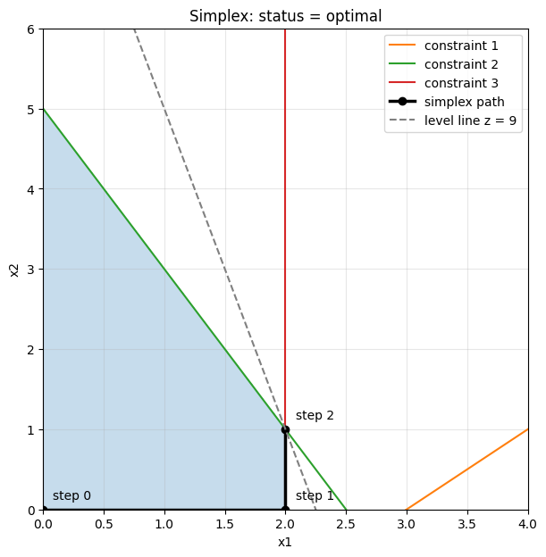
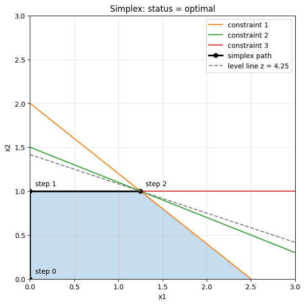
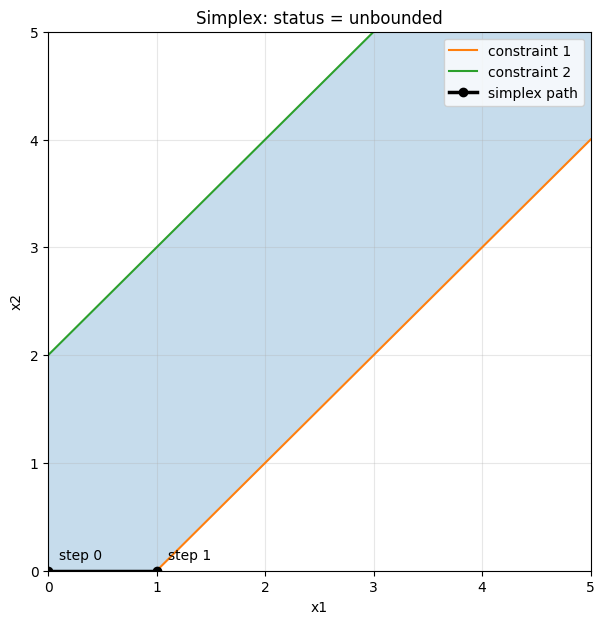
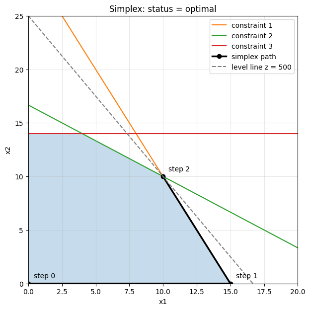

# Simplex Method from Scratch

A from-scratch Python implementation of the simplex method for linear programming, with a graphical view of the path the algorithm follows.

<p align="center">
  
</p>

## Motivation

I started this project during the **Combinatorial Optimization** course. I wanted to understand the simplex algorithm by writing it myself instead of using it as a black box. Each function corresponds to one step of the theory, so the code reads like the algorithm on the slides.

## Theory in brief

**Standard form.** The problem must be in standard form:

$$\max\ c^T x \quad \text{s.t.} \quad Ax = b,\quad x \ge 0.$$

Each $\le$ constraint becomes an equality by adding one slack variable.

**Vertices and bases.** By the fundamental theorem of linear programming, if an optimum exists, it is attained at a vertex of the feasible polyhedron. Vertices correspond to *basic feasible solutions*: choose $m$ columns $B$ of $A$ (the basis), set the non-basic variables to zero, and solve

$$A_B\, x_B = b.$$

So the algorithm jumps from one basis to another instead of searching the whole space.

**Reduced costs.** The reduced costs tell how steep each edge leaving the current vertex is:

$$r = c - \pi^T A, \qquad A_B^T\, \pi = c_B.$$

If no $r_j$ is positive, the vertex is optimal. Otherwise a variable $x_q$ with $r_q > 0$ enters the basis.

**Ratio test.** Along the edge the basic variables move as $x_B + t\, y_B$, with

$$y_B = -A_B^{-1} A_q,$$

and the step stops at the first wall, i.e. the first basic variable that reaches zero:

$$t^* = \min_{i\,:\,y_i < 0} \frac{x_i}{-y_i}.$$

That variable leaves the basis. If no basic variable decreases, nothing stops the step and the problem is **unbounded**.

The simplex path always goes from a vertex to an adjacent one along the edges of the polyhedron, and the objective never gets worse.

## Code structure

Everything is in [`simplex.ipynb`](simplex.ipynb). Each iteration performs five steps, one function each:

| Function | What it does |
|---|---|
| `base_solution` | Where am I: non-basic variables at zero, basic ones from $A_B x_B = b$. |
| `reduced_costs` | The slope of each edge: $r = c - \pi^T A$ with $A_B^T \pi = c_B$. |
| `entering_variable` | If no slope is positive the current vertex is optimal; otherwise pick the steepest one (Dantzig's rule). |
| `direction` | How the basic variables move: $y_B = -A_B^{-1} A_q$. |
| `ratio_test` | Finds the first wall (minimum ratio), hence the leaving variable; if no variable decreases, the problem is unbounded. |

On top of these:

| Function | What it does |
|---|---|
| `simplex(c, A, b, base, max_iter=100)` | Main loop. Returns a dict with `status`, `x`, `z`, `path` and the final `base`. |
| `plot_simplex` | For problems with two original variables, draws the feasible polygon, the constraints, the simplex steps and the level line at the optimum. |
| `run_test` | Solves a problem with `simplex` and with SciPy's `linprog`, prints both and plots the path. |

### Implementation choices

- **Small functions, one per concept.** Each one can be tested on its own, and the code reads like the theory.
- **General input.** The main function receives `c`, `A`, `b`, so it works on any problem in standard form, not only on the example.
- **The initial basis is a parameter.** Finding one in general requires the two-phase method, which is not implemented. With $\le$ constraints and $b \ge 0$ you can start from the origin with the slacks in the basis.
- **Feasibility check.** At the start the function checks that the initial basis is feasible, otherwise it raises a `ValueError`.
- **No side effects.** The basis is copied (`list(base)`) so the caller's list is not modified.
- **`max_iter`** keeps the algorithm from looping forever if it cycles on degenerate vertices.
- **Float arrays.** With integer arrays NumPy silently truncates decimal values.
- **No inverse matrices.** `np.linalg.solve` is used instead, which is faster and more accurate.
- **Tolerance.** Comparisons with zero use a tolerance (`1e-9`), because floating point arithmetic introduces small rounding errors.
- **`ratio_test` returns the position in the basis list**, so the basis update is simply `base[p] = q`.
- **Rich result.** The result is a dictionary with status, solution, objective value, path and final basis.
- **The path is saved for the plot.** With two original variables it is drawn on the plane, together with the polygon, the constraints and the level line at the optimum.

## Tests

Each case is solved with `simplex` and with SciPy's `linprog` (HiGHS). **In all three cases SciPy gives the same result.**

| Case | Problem | Expected result | `simplex` | SciPy |
|---|---|---|---|---|
| Regular (slides example) | $\max\ 4x_1 + x_2$ <br> $x_1 - x_2 \le 3,\ 2x_1 + x_2 \le 5,\ x_1 \le 2$ | optimum $(2, 1)$, $z = 9$ | ✅ | ✅ |
| Degenerate | $\max\ x_1 + 3x_2$ <br> $4x_1 + 5x_2 \le 10,\ 4x_1 + 10x_2 \le 15,\ x_2 \le 1$ | optimum $(1.25, 1)$, $z = 4.25$ | ✅ | ✅ |
| Unbounded | $\max\ x_1 + x_2$ <br> $x_1 - x_2 \le 1,\ -x_1 + x_2 \le 2$ | status `unbounded` | ✅ | ✅ |

In the degenerate case three constraint lines meet at the optimum. The final basis is `[0, 3, 1]`: the slack $x_4$ is in the basis but equals zero.

<p align="center">
  
  
</p>

## Real case: the carpentry workshop

A small carpentry workshop makes tables and chairs:

- a table needs 4 units of wood and 2 hours of work, and earns €30;
- a chair needs 2 units of wood and 3 hours of work, and earns €20;
- each week 60 units of wood and 50 hours of work are available;
- the market buys at most 14 chairs per week.

How many tables ($x_1$) and chairs ($x_2$) should be made to maximize the profit?

$$
\begin{aligned}
\max\ & 30x_1 + 20x_2 \\
\text{s.t.}\ & 4x_1 + 2x_2 \le 60 \quad \text{(wood)} \\
& 2x_1 + 3x_2 \le 50 \quad \text{(hours)} \\
& x_2 \le 14 \quad \text{(chair demand)} \\
& x_1,\ x_2 \ge 0
\end{aligned}
$$

**Solution:** 10 tables and 10 chairs, for a profit of **€500**. Wood and hours are fully used. The chair demand has 4 units of slack (only 10 of the 14 chairs are made). The simplex reaches the optimum in two steps: $(0,0) \to (15,0) \to (10,10)$.

<p align="center">
  
</p>

## How to run

```bash
pip install -r requirements.txt
```

Then open `simplex.ipynb` in Jupyter, VS Code or any notebook environment and run all cells.

## Limitations

- **A feasible initial basis is required**: phase 1 of the two-phase method is missing.
- **Dantzig's rule does not prevent cycling** on degenerate vertices; an anti-cycling rule such as Bland's rule would be needed (`max_iter` only stops the loop).
- **The plot works only with two original variables.**
- **It is meant for understanding the algorithm, not for large problems.** For those, use solvers such as [HiGHS](https://highs.dev/) or [Gurobi](https://www.gurobi.com/).

## Possible developments

- Two-phase method, to find the initial basis automatically.
- Bland's rule, to avoid cycling.
- Printing the dictionary (tableau) at each iteration.
- Computing the shadow prices (dual solution).
